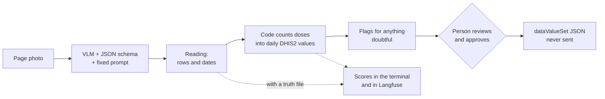

# handwritten-forms-vlm-bench

**Which vision model reads your handwritten form well enough to trust, and how would you know?**

A benchmark for reading photos of handwritten forms with local vision-language models (VLMs) and turning them into [DHIS2](https://dhis2.org) aggregate data. It measures what matters for that data, not only how close the text is: the daily values that would actually be reported, and whether every mistake was flagged for a person to check.

**Case study:** the R-06 Immunisation Register. Health workers fill it in daily. Instead of re-counting it onto tally sheets every week, they photograph the pages; a model reads them, code counts every dose by date into daily RI v2 values, and a person reviews and approves. Nothing is ever sent to DHIS2 by this project.

## How it works



- **The model only reads.** One call per page photo, the same prompt and JSON schema every time (`register/prompts.py`), temperature 0 and a fixed seed. The schema has no fields for names, phones or villages, so they cannot come back.
- **Code does the counting.** Dates are parsed, ages computed from the birth date, and values mapped to DHIS2 data elements and category option combos from the data set metadata (`register/spec.py`, `register/aggregate.py`).
- **Anything doubtful is flagged and not counted** until a person resolves it.

## Quick start

Requirements: [uv](https://docs.astral.sh/uv/), [Ollama](https://ollama.com), and optionally a self-hosted [Langfuse](https://langfuse.com/self-hosting).

```bash
cp .env.example .env        # Langfuse keys (optional), DHIS2 login (only for `metadata`)
uv sync
ollama pull qwen3.5:4b      # or any vision model Ollama can serve

uv run formbench --help     # every command
uv run formbench scores     # what every score means
```

Private inputs, all kept out of git:

- `data/private/samples/`: the blank register PDF
- `data/private/photos/`: your real photos
- `data/private/synthetic/`: generated scenarios
- `schemas/ri_v2/metadata.json`: the DHIS2 data set metadata (`formbench metadata --dataset <uid>`)

## Test a model

```bash
# One photo, one model: every wrong cell, the scores, a Langfuse trace
uv run formbench eval --engine ollama:qwen3.5:4b \
    --scenario data/private/synthetic/neat-scan --photo week-01/page-2026-07-s1.jpg

# Your own photo: run once, correct the saved reading by hand into page.truth.json, rerun
uv run formbench eval --engine ollama:qwen3.5:4b --image data/private/photos/page.jpg
uv run formbench eval --engine ollama:qwen3.5:4b --image data/private/photos/page.jpg \
    --truth data/private/photos/page.truth.json

# A whole folder, one or more models: a synthetic scenario (weeks, review, approval),
# or a folder of photos that each have a <photo>.truth.json
uv run formbench bench --scenario data/private/synthetic/bad-poor \
    --engine ollama:qwen3.5:4b --engine ollama:<another-model>

# Compare every saved run, per model
uv run formbench compare results/register/bench/*.json
```

**Making more test data.** Synthetic registers are drawn on the real blank page, with known answers. Writers range from neat to terrible, and photos from flat scans to dim and blurred:

```bash
uv run formbench template        # once: find the grid of the blank PDF
uv run formbench synth --name bad-poor --seed 25 --weeks 2 --messiness bad --quality poor
```

The same seed always gives the same photos.

**Options:**

- `--max-side 4096`: send a larger image
- `--think`: let thinking models think
- `VLM_TIMEOUT=900` in `.env`: allow more seconds per call

## Choosing a model

1. **Use the same conditions for every model:** the same folders and options.
2. **Rank them by the "decide" scores:**
   - `value_accuracy_after_review`: what DHIS2 would get
   - `misread_flag_recall`: how many mistakes the reviewer gets to see
   - `field_f1` / `tree_f1`: reading quality
3. **Use the "reading" scores to explain why.**
   - High ANLS with low Tree F1: it reads well but files values under the wrong column.
   - High `omission_rate`: it skips dates.
   - High `hallucination_rate`: it invents dates in empty cells.
4. **Only trust clear gaps.** A rerun of the same photo can differ in a cell or two, so treat gaps of about 2 points or less as noise. A model should win in most scenarios, not just overall.
5. **Check the cost.** Multiply `latency_s_per_page` by the pages photographed per week.

In Langfuse, every folder is a dataset and every `bench` run is one of its runs. Open **Datasets → \<folder\> → Runs** to compare models side by side, with whole-run scores and every photo's trace. Every score carries its description there.

## Weekly use

```bash
# In .env: REGISTER_GO_LIVE=YYYY-MM-DD (doses dated before it are never counted)
uv run formbench run --week 2026W44 --cover cover.jpg --pages p1.jpg p2.jpg --engine ollama:qwen3.5:4b
# -> results/register/<week>_<time>/review.html and decisions.yaml: resolve every flag, then
uv run formbench approve --run results/register/<week>_<time> --reviewer "Your Name"
# -> datavalueset.json. It is written for a person to import; nothing is sent to DHIS2.
```

## Using it for a different form

The project is built so that only one folder knows about the R-06:

| Keep as is | Replace for your form |
| --- | --- |
| `vlm.py`: one schema-constrained call to a local model, traced | `register/prompts.py`: your fields, schema and prompt |
| `metrics.py`: CER, WER, ANLS, list matching, tree edit distance | `register/spec.py`: which field maps to which DHIS2 data element and category option combo |
| `evaluation/tracking.py`: Langfuse datasets, experiments, score definitions | `register/aggregate.py`: how readings become counts (a tally form may need no counting at all) |
| `evaluation/bench.py`, `photo.py`: running models over photos with truth files | `evaluation/scoring.py`: keep the text and cell scores; the value scores call your aggregation |
| `dhis2.py`: read-only metadata download | |

Start with 20–30 real photos and hand-made truth files in one folder, run `formbench bench` on it for each candidate model, and compare. Synthetic data helps you see failure modes; only real photos tell you how a model does on your form.

## Project layout

```text
src/formbench/
  cli.py          the formbench command; every option is defined here
  vlm.py          model call    metrics.py  generic scores    dhis2.py  read-only DHIS2
  register/       the R-06 form: prompt and schema, reader, dates, counting
  evaluation/     scores, benchmark runs, the stand-in reviewer, Langfuse
  weekly/         draft, review page, approval, dataValueSet
  synthetic/      blank-page template, simulated registers, handwriting and photo effects
docs/adr/         why things are the way they are
```

## Results so far

qwen3.5:4b, whole-page photos, 6 synthetic scenarios (27 photos, neat scans to terrible handwriting):

- **Values after review:** 30% of daily values right
- **Misread flag recall:** 52% of misreads flagged
- **Field F1:** 0.58
- **Main failure:** dates read correctly but filed under the neighbouring narrow column

Details in [ADR 0005](docs/adr/0005-register-evaluation-metrics.md).

## Rules this project keeps

- **DHIS2 is read-only.** Metadata and org unit lookups only; the payload is written to a file.
- **A person approves every week,** even with no flags.
- **Private data stays local.** Photos, the blank register, the metadata snapshot, synthetic data and results are never committed.
- **Tests need nothing running.** No Ollama, Langfuse or network: `uv run pytest -q`.

Design decisions: [ADR 0003](docs/adr/0003-vlm-structured-output-and-thinking.md) structured output, [0004](docs/adr/0004-register-to-daily-aggregates.md) register to daily values, [0005](docs/adr/0005-register-evaluation-metrics.md) scores, [0006](docs/adr/0006-benchmark-runs-as-langfuse-experiments.md) Langfuse experiments.

## License

MIT
