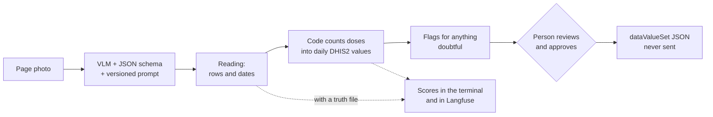

# handwritten-forms-vlm-bench

**Which vision model reads your handwritten form well enough to trust, and how would you know?**

A benchmark for reading photos of handwritten forms with local vision-language models (VLMs) and turning them into [DHIS2](https://dhis2.org) aggregate data. It measures what matters for that data, not only how close the text is: the daily values that would actually be reported, and whether every mistake was flagged for a person to check.

**Case study:** a paper immunisation register. Health workers fill it in daily. Instead of re-counting it onto tally sheets every week, they photograph the pages; a model reads them, code counts every dose by date into daily immunisation values, and a person reviews and approves. Nothing is ever sent to DHIS2 by this project.

## How it works



- **The model only reads.** One call per page photo with a fixed JSON schema (`register/prompts.py`) and a prompt versioned in Langfuse, temperature 0 and a fixed seed. The schema has no fields for names, phones or villages, so they cannot come back.
- **Code does the counting.** Dates are parsed, ages computed from the birth date, and values mapped to DHIS2 data elements and category option combos from the data set metadata (`register/spec.py`, `register/aggregate.py`).
- **Anything doubtful is flagged and not counted** until a person resolves it.

## Quick start

Requirements: [uv](https://docs.astral.sh/uv/), [Ollama](https://ollama.com), and optionally a self-hosted [Langfuse](https://langfuse.com/self-hosting).

```bash
cp .env.example .env        # Langfuse keys (optional), DHIS2 login (only for `metadata`)
uv sync
ollama pull qwen3.5:4b      # or any vision model Ollama can serve

uv run formbench --help     # every command
uv run formbench scores     # what every score means
```

Private inputs, all kept out of git:

- `data/private/samples/`: the blank register PDF
- `data/private/photos/`: your real photos
- `data/private/synthetic/`: generated scenarios
- `schemas/dataset/metadata.json`: the DHIS2 data set metadata (`formbench metadata --dataset <uid>`)

## Compare models on your own photos

**1. Put the photos and their truth side by side** in one folder (the folder is your dataset):

```text
data/private/photos/my-pages/
  page-1.jpg   page-1.json
  page-2.jpg   page-2.json
```

A truth file lists what is really written, one object per child row. Name each column by
its letter, its key, or both:

```json
{"cohort_month": "June", "cohort_year": "2026",
 "rows": [{"A": "1", "D": "7654", "G": "M", "birth_date": "03-06-26", "age": "1/12",
           "I": "05-06-26", "K": "05-06-26", "L": "17-07-26"}]}
```

- Column C holds two values: call them `birth_date` and `age`.
- Leave blank cells out. Name, guardian, phone and village columns are ignored.
- A plain list of rows works too. The month and year are only scored if you include them.
- A misspelled column stops the run and lists the valid ones.

**2. Run each model on the folder**, one run per model (or several `--engine` at once):

```bash
uv run formbench bench --folder data/private/photos/my-pages --engine ollama:qwen3.5:4b
uv run formbench bench --folder data/private/photos/my-pages --engine ollama:hf.co/ibm-granite/granite-vision-4.1-4b-GGUF:Q8_0
```

**3. See every model side by side:**

```bash
uv run formbench compare --folder my-pages
```

Example output (one column per model):

```text
                                   qwen3.5:4b   granite-vision
Reading accuracy
  Overall accuracy ↑                    51.0%            ...
  Completeness ↑                        53.4%
  Reliability ↑                         63.3%
  Rows detected ↑                       98.0%
  Processing success rate ↑            100.0%
DHIS2 reporting
  Reporting accuracy ↑                  29.0%
Performance
  Processing time (seconds per page) ↓  101.1
```

**4. See what one model got wrong on one photo,** cell by cell (the truth is found next to it):

```bash
uv run formbench eval --engine ollama:qwen3.5:4b --image data/private/photos/my-pages/page-1.jpg
```

No truth yet? Run `eval` on the photo anyway, then correct the reading it saves into a truth
file.

**Options:** `--max-side 3072` sends a smaller image (the default, 4032, is a 12 MP phone photo as
taken; smaller photos are never enlarged), `--think` lets thinking models think, and
`VLM_TIMEOUT=900` in `.env` allows more seconds per call.

## What the scores mean

A **cell** is one value in one row and column. It is right when the model put the same value
under the same column. Dates count as the same if they are the same day (`5/6/26` = `05-06-26`).

| Score | What it tells you |
| --- | --- |
| **Overall accuracy** | **The main score.** Of every cell that has a value on the page or in the output, the share that is right. |
| Completeness | Of the entries written on the page, the share captured correctly. Low: it misses or misreads. |
| Reliability | Of the values the model reported, the share that are correct. Low: it invents values or records them under the wrong column. |
| Rows detected | Child rows found, by serial number. |
| Processing success rate | Photos that produced a usable answer at all. |
| Reporting accuracy | Daily DHIS2 values counted from its reading that equal those counted from the truth. Stricter: needs birth date and sex right too. |
| Processing time | Seconds per page on this machine. |

Synthetic scenarios add three: reporting accuracy after review, error detection rate and review
workload (see below). `uv run formbench scores` prints all of them.

**Choosing a model:**

1. **Use the same photos and options for every model.**
2. **Rank by overall accuracy.** Then completeness and reliability tell you why one is worse:
   it misses things, or it makes things up.
3. **Only trust clear gaps.** Runs are repeatable (temperature 0, fixed seed), but with a few
   photos one cell is several points, so treat small gaps as a tie. More photos, smaller noise.
4. **Check the speed:** seconds per page times the pages you photograph each week.

In Langfuse, every folder is a dataset and every run one of its runs: open **Datasets →
\<folder\> → Runs** to compare models, with every photo's trace and scores.

## Improve the prompt

The page prompt is versioned in Langfuse under **Prompts → register-page**. The first run saves
the prompt in code (`register/prompts.py`) there as version 1, labelled `production`.

1. **Write a new version** in Langfuse: open the prompt, create a new version, edit the text
   and say what you changed in the commit message.
2. **Run it** on the same folder and models as before:

   ```bash
   uv run formbench bench --folder data/private/photos/my-pages --engine ollama:qwen3.5:4b --prompt 2
   ```

   `--prompt` takes a version number or a label you gave a version (`--prompt candidate`).
   Without it, a run uses the `production` version. `eval` takes `--prompt` too.
3. **Compare.** `formbench compare --folder my-pages` shows one column per model and prompt
   version (`qwen3.5:4b prompt v2`). In Langfuse, each run is named after its prompt version,
   every model call is linked to the version it used, and **Datasets → my-pages → Runs** puts
   runs side by side, photo by photo.
4. **Promote the winner.** Move the `production` label to a version that is better on every
   model you care about. Weekly runs (`formbench run`) use the `production` version.

The prompt changes what the model is told, not what it must return: the keys and their
descriptions come from the schema in code. A version or label that does not exist stops the
run, so a run is never labelled with a prompt it did not use. Without Langfuse, the prompt in
code is used and the run has no prompt version. Runs saved before prompts were versioned show
the model name only.

## Tally sheets

A **tally sheet** holds totals, one digit per box, in sections framed by black squares at
their corners. It is photographed one section at a time, or one whole page at a time. (A
register, above, is a list: one row per person.) Tally sheets are scored with the same reading scores; there is no DHIS2 step.

**1. Describe the form once** in `form.json` (kept out of git with the photos): its sections
and their fields. Each field is a `count`, `digits` (a code), `text`, `date`, `choice` (the
filled circle, with its `options`) or `mark` (signed or not):

```json
{"id": "weekly-tally", "name": "Weekly tally sheet",
 "sections": {"A": {"title": "Session details", "fields": [
                {"key": "Week starting", "type": "date"},
                {"key": "Region", "type": "choice", "options": ["North", "South"]}]},
              "B": {"title": "Screening", "fields": [
                {"key": "Screened_6-11 m_Male", "type": "count"}]}},
 "pages": ["A", "B"]}
```

`pages` lists the sections printed on each page, page 1 first (without it, one page holds every
section). It is only needed for whole-page photos.

**2. Put one photo per section and one truth file per filled sheet** in a folder, with
`form.json` in the folder or the one above it:

```text
data/private/tally/
  form.json
  my-sheets/
    sheet-01.json                      every field of the sheet: {"Week starting": "19/10/2026", ...}
    sheet-01_A.jpg  sheet-01_B.jpg ...  one photo per section, named <sheet>_<section>
    sheet-01.jpg  sheet-01_p2.jpg      whole pages, if you also want to try those (optional)
```

Each photo is scored on its own section's fields. Counts compare as numbers (`007` = 7, and an
empty box = 0), dates as dates, text ignoring case and spacing.

**3. Run and compare:**

```bash
uv run formbench tally --folder data/private/tally/my-sheets --engine ollama:qwen3.5:9b
uv run formbench compare --folder my-sheets
```

One prompt per form, versioned in Langfuse as `tally-<form id>`, serves every section:
`{{section}}`, `{{title}}` and `{{fields}}` are filled in for the photo. Keep them when editing
it. `--prompt`, `--max-side`, `--think` and `--rescore` work as for `bench`.

**Whole pages instead of sections.** `--pages` benchmarks the whole-page photos of the same
sheets (`<sheet>.jpg` is page 1, `<sheet>_p2.jpg` page 2) against the same truth files, so
`compare` shows both ways of taking photos side by side ("full pages" in the column name):

```bash
uv run formbench tally --folder data/private/tally/my-sheets --pages --engine ollama:qwen3.5:9b
```

Each page is read in one call with its own prompt, `tally-<form id>-page` in Langfuse, where
`{{fields}}` lists the fields of every section on the page; it is scored on those sections.

Photos are sent exactly as they are in the folder, section and page photos alike: never
enlarged or re-compressed (only a photo over `--max-side`, or one stored sideways, is
converted). To try an enlarged or cropped photo, make it yourself and put it in its own
folder with a copy of the truth file.

## Synthetic test data

Synthetic registers are drawn on the real blank page, with known answers. Writers range from
neat to terrible, and photos from flat scans to dim and blurred:

```bash
uv run formbench template        # once: find the grid of the blank PDF
uv run formbench synth --name bad-poor --seed 25 --weeks 2 --messiness bad --quality poor
uv run formbench bench --folder data/private/synthetic/bad-poor --engine ollama:qwen3.5:4b
```

The same seed always gives the same photos. A scenario also runs the weekly workflow with a
stand-in reviewer who fixes only what was flagged, which adds **reporting accuracy after
review** (below 100% means wrong numbers nobody was warned about), **error detection rate**
and **review workload**.

## Weekly use

```bash
# In .env: REGISTER_GO_LIVE=YYYY-MM-DD (doses dated before it are never counted)
uv run formbench run --week 2026W44 --cover cover.jpg --pages p1.jpg p2.jpg --engine ollama:qwen3.5:4b
# -> results/register/<week>_<time>/review.html and decisions.yaml: resolve every flag, then
uv run formbench approve --run results/register/<week>_<time> --reviewer "Your Name"
# -> datavalueset.json. It is written for a person to import; nothing is sent to DHIS2.
```

## Using it for a different form

The project is built so that only one folder knows about the register:

| Keep as is | Replace for your form |
| --- | --- |
| `vlm.py`: one schema-constrained call to a local model, traced | `register/prompts.py`: your fields, schema and prompt |
| `metrics.py`: text similarity and row matching | `register/spec.py`: which field maps to which DHIS2 data element and category option combo |
| `evaluation/tracking.py`: Langfuse datasets, experiments, score definitions | `register/aggregate.py`: how readings become counts (a tally form may need no counting at all) |
| `evaluation/bench.py`, `photo.py`: running models over photos with truth files | `evaluation/scoring.py`: keep the cell scores; the DHIS2 value scores call your aggregation |
| `dhis2.py`: read-only metadata download | `evaluation/truth.py`: your column letters and names |

Start with 20–30 real photos and hand-made truth files in one folder, run `formbench bench` on it for each candidate model, and compare. Synthetic data helps you see failure modes; only real photos tell you how a model does on your form.

## Project layout

```text
src/formbench/
  cli.py          the formbench command; every option is defined here
  vlm.py          model call    metrics.py  generic scores    dhis2.py  read-only DHIS2
  register/       the register form: prompt and schema, reader, dates, counting
  evaluation/     scores, benchmark runs, the stand-in reviewer, Langfuse
  weekly/         draft, review page, approval, dataValueSet
  synthetic/      blank-page template, simulated registers, handwriting and photo effects
docs/adr/         why things are the way they are
```

## Results so far

qwen3.5:4b, whole-page photos, 6 synthetic scenarios (27 photos, neat scans to terrible handwriting):

- **Overall accuracy:** 51%
- **Reporting accuracy after review:** 30%, with an error detection rate of 52%
- **Main failure:** dates read correctly but filed under the neighbouring narrow column

Details in [ADR 0005](docs/adr/0005-register-evaluation-metrics.md) and [ADR 0007](docs/adr/0007-fewer-plainly-named-scores.md).

## Rules this project keeps

- **DHIS2 is read-only.** Metadata and org unit lookups only; the payload is written to a file.
- **A person approves every week,** even with no flags.
- **Private data stays local.** Photos, the blank register, the metadata snapshot, synthetic data and results are never committed.
- **Tests need nothing running.** No Ollama, Langfuse or network: `uv run pytest -q`.

Design decisions: [ADR 0003](docs/adr/0003-vlm-structured-output-and-thinking.md) structured output, [0004](docs/adr/0004-register-to-daily-aggregates.md) register to daily values, [0005](docs/adr/0005-register-evaluation-metrics.md) scores, [0006](docs/adr/0006-benchmark-runs-as-langfuse-experiments.md) Langfuse experiments, [0007](docs/adr/0007-fewer-plainly-named-scores.md) the scores and truth files, [0008](docs/adr/0008-prompts-versioned-in-langfuse.md) prompt versions, [0009](docs/adr/0009-tally-sheets-by-section.md) tally sheets, [0010](docs/adr/0010-tally-whole-page-photos.md) whole-page photos.

## License

MIT
