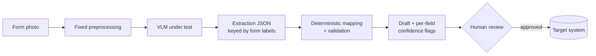

# handwritten-forms-vlm-bench

**Can a small, phone-sized vision-language model reliably read handwritten forms, and know when it can't?**

A reproducible benchmark for extracting structured data from photos of handwritten forms with vision-language models (VLMs), from sub-1B on-device models to 30B+ server models. Every extracted field carries a confidence flag, and nothing is imported without human review.

**Case study:** daily aggregate health data forms submitted to [DHIS2](https://dhis2.org), the health information system used in 80+ countries. The same pattern applies to any paper-heavy workflows such as bank and KYC forms, insurance claims, field surveys etc.

> **Status:** v0.1 in progress. Evaluation harness and experiment tracking are being built. No benchmark results yet.

---

## Why this exists

Millions of paper forms are still typed into systems by hand. VLMs can read them, but in any setting where errors matter, three questions decide whether that is usable:

1. **How accurate is it, per field type?** Numbers, names, dates and option choices fail differently.
2. **How small can the model be?** On-device inference works offline and keeps documents on the phone.
3. **Does the model know when it's wrong?** Errors are acceptable only if they get flagged for a human.

This project answers those with measurements rather than demos.

## Approach



- **Two-stage extraction.** The model only reads what is written. Plain code maps values to system IDs and validates them. The model never outputs IDs and never writes to the target system.
- **Identity fields are matched, not generated.** Handwritten facility names, dates and options are transcribed, then resolved against the list of valid values, with ambiguity flagged.
- **Confidence from verifiable signals**, not model self-reports: token probabilities, rule checks, cross-field validation, history checks and self-consistency.
- **Human-in-the-loop by design.** Low- and medium-confidence fields are highlighted for the reviewer. Only an approved draft is imported, after a dry run.

## Evaluation

Every model runs against the same frozen dataset, prompt version, preprocessing and decoding settings. Only the model changes. Experiments are tracked in a self-hosted [Langfuse](https://langfuse.com) instance.

| Metric | What it measures |
| --- | --- |
| `json_valid` | Output parses and matches the schema |
| `numeric_accuracy` | Count fields read exactly right |
| `text_cer` | Character error rate on free-text fields |
| `orgunit_match` / `period_match` | Identity fields resolved to the correct object |
| `hallucination_rate` | Values invented for blank fields |
| `flag_recall` | Share of wrong fields that were flagged for review |
| `flag_rate` | Share of all fields flagged (reviewer workload) |
| `latency_s`, `peak_mem_gb` | Feasibility on device |

**Decision rule:** among models that pass a fixed quality gate, prefer the smallest. A model whose errors are reliably flagged can beat a more accurate model that is confidently wrong.

### Model tiers

| Tier | Size | Target |
| --- | --- | --- |
| 0 | n/a | Classic handwriting OCR + rules (baseline) |
| 1 | < 1B | Budget phones |
| 2 | 1–4B | Mid-range phones (primary on-device target) |
| 3 | 7–12B | High-end phones, laptops |
| 4 | 30B+ | Server |

## Data

All public data is **constructed**: values are generated first as ground truth, then handwritten onto blank forms by different people and photographed under varied conditions. No real patient or facility data is in this repository.

## Roadmap

- [ ] **v0.1:** Harness, Langfuse tracing, schema generation from DHIS2 metadata, OCR baseline
- [ ] **v0.2:** Constructed dataset v1, tiers 0–2 benchmarked, failure gallery
- [ ] **v0.3:** Confidence flags and flag-recall evaluation
- [ ] **v1.0:** Held-out form layout, real-device run, server-tier ceiling, full write-up

## Run it

Requirements: macOS or Linux, [uv](https://docs.astral.sh/uv/), [Docker](https://www.docker.com/), [Ollama](https://ollama.com).

```bash
# 1. Start Langfuse locally (see https://langfuse.com/self-hosting), create a project and API keys
# 2. Configure
cp .env.example .env            # add your Langfuse keys
uv sync
# 3. Pull a small vision model
ollama pull qwen2.5vl:3b
# 4. Smoke test: one image, one traced call
uv run --env-file .env python src/formbench/smoke.py data/synthetic/samples/sample-01.jpg qwen2.5vl:3b
```

Full benchmark commands will be added in v0.2.

## Tech

Python · uv · Langfuse · Ollama / llama.cpp · MLX · OpenAI-compatible serving · DHIS2 Web API · GitHub Actions

## License

MIT
